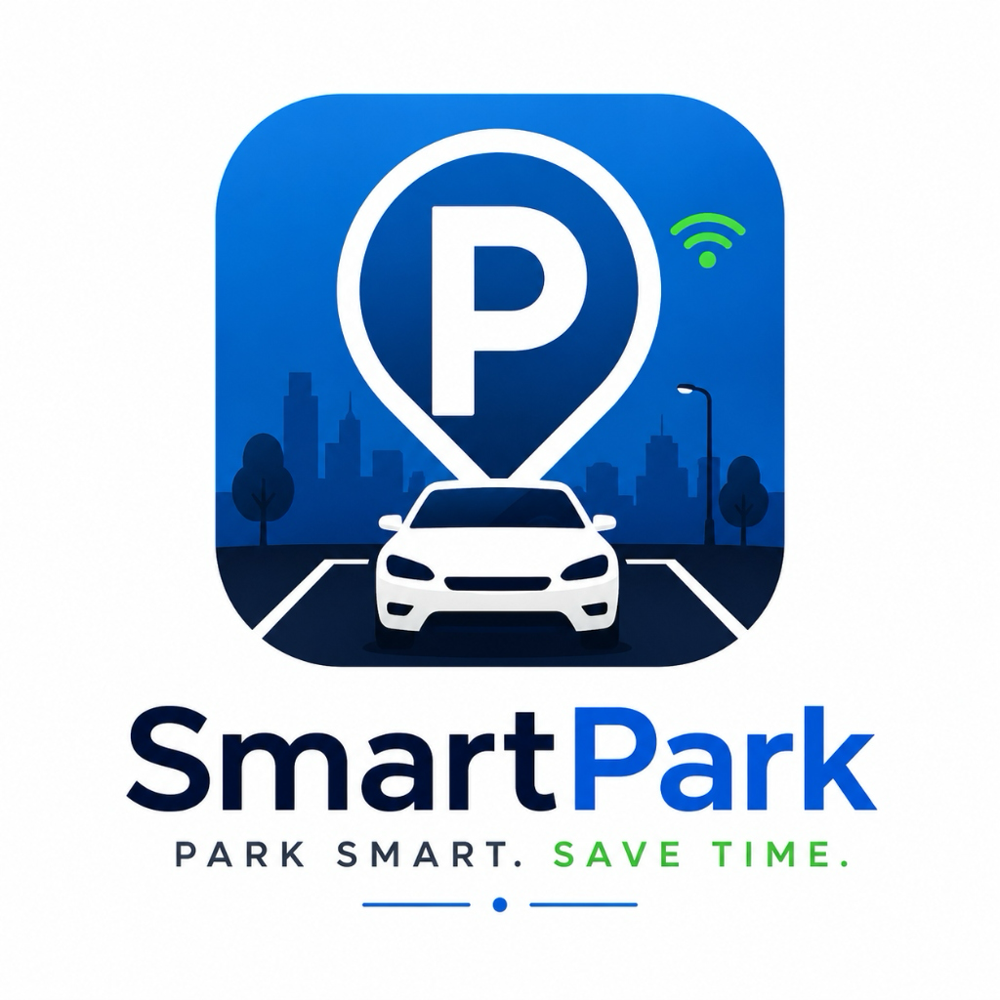

# SmartPark AI — Production-Minded Smart Parking Platform

<p align="center">
  
</p>

<p align="center">
  <strong>Park Smart. Save Time.</strong><br/>
  Full-stack smart parking platform powered by machine-learning demand forecasting, real-time occupancy synchronization, turn-by-turn entrance navigation, and facility operations management.
</p>

---

## 1. System Architecture

SmartPark AI is organized as a unified monorepo with 4 connected applications and services:

- **Mobile Application (`apps/mobile`)**: React Native & Expo SDK 52 application featuring 5 tabs (Home, Find Parking, Bookings, Activity, Profile), next-hour ML forecast chart, Find My Vehicle indoor/outdoor tracking, turn-by-turn navigation, and reservation flows.
- **REST API Backend (`services/backend`)**: Node.js & Express REST API in TypeScript backed by persistent MongoDB 7.0 (WiredTiger), JWT authentication, Zod validation, and Socket.IO real-time event broadcasting.
- **ML Prediction Service (`services/ml-service`)**: Python FastAPI microservice serving next-hour parking demand forecasts using an out-of-sample evaluated Gradient Boosting model with transparent trend explanations and uncertainty intervals.
- **Admin Dashboard (`apps/admin-dashboard`)**: React 18, Vite, and TypeScript administrative web portal for garage operators to monitor live occupancy, override counts, resolve incidents, and inspect audit logs.
- **Shared Package (`packages/shared`)**: Shared TypeScript data contracts, validation schemas, and authoritative brand assets.

---

## 2. Official Brand Logo Integration

The authoritative brand logo provided has been preserved without distortion or recoloring across all applications:

| Asset Location | Usage | Resolution |
| :--- | :--- | :--- |
| `packages/shared/assets/brand/smartpark-logo.png` | Shared Master Asset | 1024 x 1024 |
| `apps/mobile/assets/icon.png` | Mobile App Icon | 1024 x 1024 |
| `apps/mobile/assets/adaptive-icon.png` | Android Adaptive Icon | 1024 x 1024 |
| `apps/mobile/assets/splash.png` | Mobile Splash Screen | 1024 x 1024 |
| `apps/admin-dashboard/public/favicon.png` | Browser Tab Favicon | 64 x 64 |
| `apps/admin-dashboard/public/smartpark-logo.png` | Web Dashboard Header & Login | 1024 x 1024 |

---

## 3. Running in VS Code & Quick Start

> [!TIP]
> **Complete VS Code Guide**: See [`docs/VSCODE_GUIDE.md`](docs/VSCODE_GUIDE.md) for 1-click VS Code tasks, F5 debugger configurations, and split-terminal setups.
> - **1-Click Run**: Open VS Code -> Press `Cmd+Shift+B` (or `Cmd+Shift+P` -> `Tasks: Run Task` -> `SmartPark: 0. Start All Services`).
> - **Unified Terminal**: Run `npm start` to stream all 4 microservices concurrently.

### Prerequisites
- Node.js v20+ (Node v22 LTS tested)
- Python 3.11+ (Python 3.14 tested)
- macOS / Linux / Windows

### 1. Start MongoDB Persistent Daemon
```bash
bash scripts/start-mongo.sh
```

### 2. Seed Initial Database Records
```bash
npm run seed:backend
```

### 3. Start ML Prediction Microservice (Port 8000)
```bash
bash scripts/start-ml.sh
```

### 4. Start REST API Backend (Port 5001)
```bash
npm run dev:backend
```

### 5. Start Admin Web Dashboard (Port 5173)
```bash
npm run dev:admin
```
Open [http://localhost:5173](http://localhost:5173) in your browser.

### 6. Start Mobile App Metro Server (Port 8081)
```bash
npm run dev:mobile:metro
# Or open directly in iOS simulator:
npm run dev:mobile
```

---

## 4. Test Credentials

The database seeder provisions pre-configured test accounts:

| Role | Email | Password | Access Level |
| :--- | :--- | :--- | :--- |
| **System Admin** | `admin@smartpark.ai` | `Admin@123456` | Full system access, audit logs, facility CRUD |
| **Facility Operator**| `operator@smartpark.ai` | `Operator@123456` | Live occupancy overrides, incident management |
| **Driver** | `driver@smartpark.ai` | `Driver@123456` | Vehicle reservations, saved locations, sessions |

---

## 5. Automated Test Suite

Run the full automated test suite across all services:
```bash
npm test
# Or: bash scripts/run-all-tests.sh
```

### Test Results Summary
- **ML Service**: 6/6 tests passed (`pytest test_ml_service.py`)
- **REST API Backend**: 10/10 tests passed (`vitest run` on `services/backend`)
- **Mobile Application**: 7/7 tests passed (`vitest run` on `apps/mobile`)
- **TypeScript**: 0 compilation errors across all projects

---

## 6. Runtime Health Check

Verify all services in a single command:
```bash
npm run health
# Or: node scripts/health-check.js
```
Output:
```
--------------------------------------------------
 SMARTPARK AI — RUNTIME SERVICE HEALTH REPORT     
--------------------------------------------------
✓ [ONLINE] ML Forecasting Service     -> http://localhost:8000/health
✓ [ONLINE] ML Readiness               -> http://localhost:8000/ready
✓ [ONLINE] Backend REST API           -> http://localhost:5001/api/v1/health
✓ [ONLINE] Backend DB Readiness       -> http://localhost:5001/api/v1/ready
✓ [ONLINE] Admin Dashboard (Vite)     -> http://localhost:5173/
✓ [ONLINE] Expo Metro Bundler         -> http://localhost:8081/
--------------------------------------------------
```
